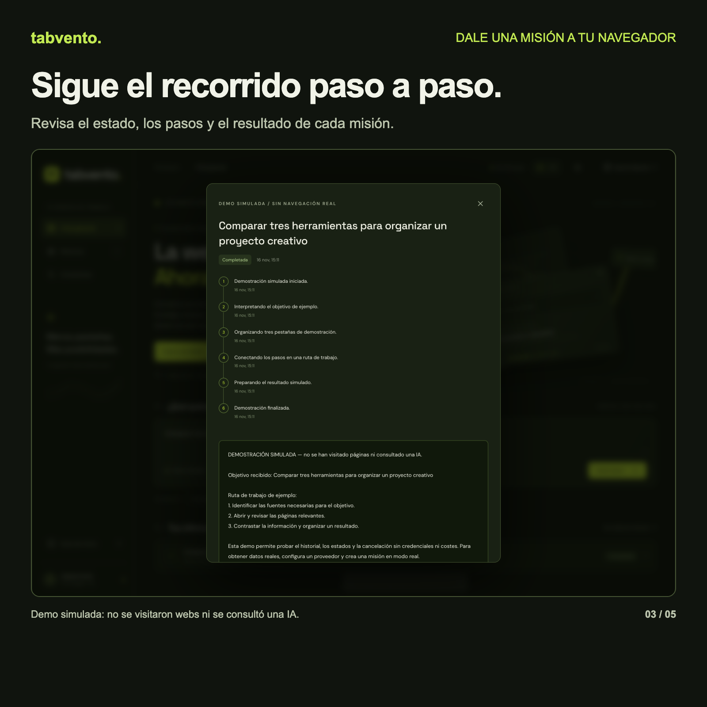
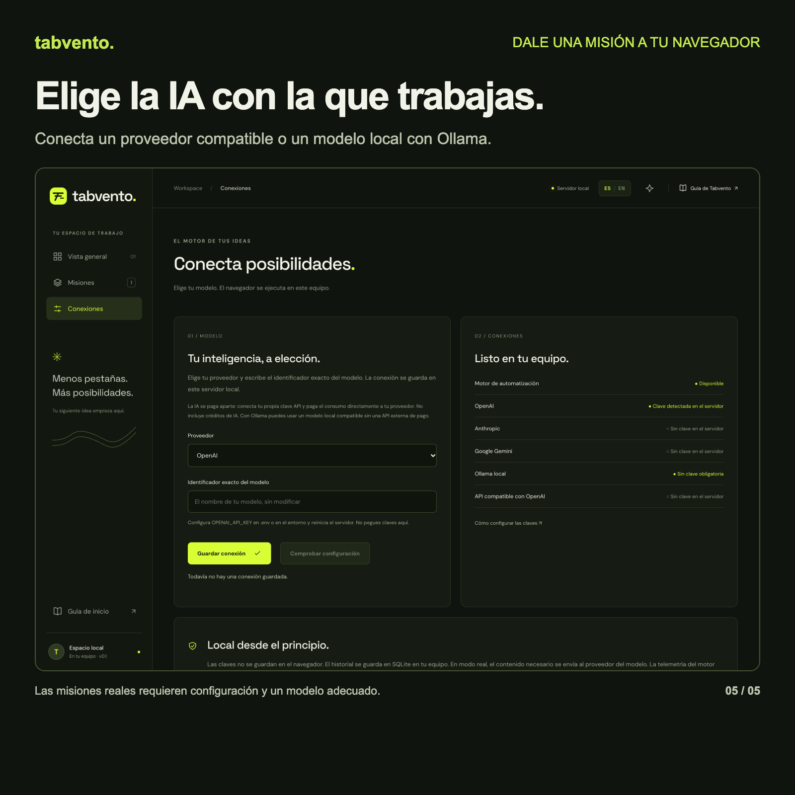
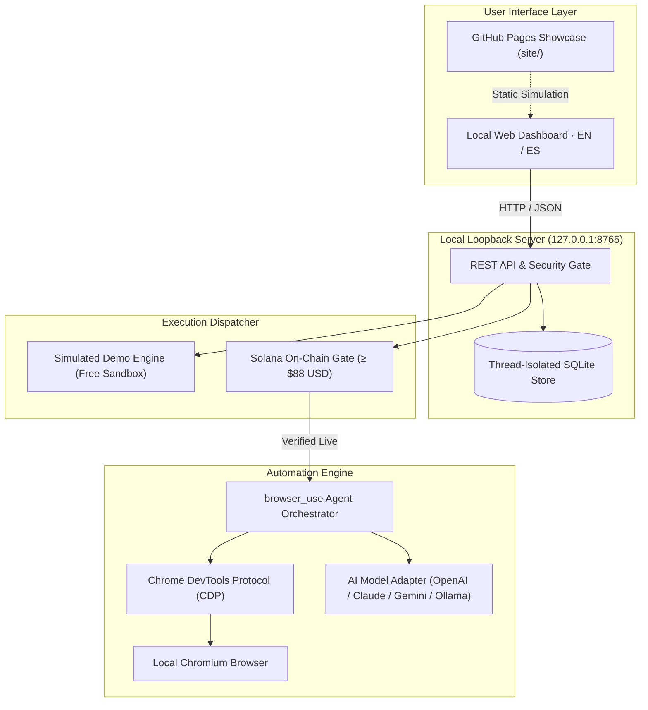

<p align="center">
  
</p>

<h1 align="center">Tabvento</h1>
<p align="center"><strong>Autonomous AI Browser Automation Dashboard</strong></p>
<p align="center">
  A local-first, privacy-focused browser automation workspace. Run keyless simulated sandbox tests or unlock full local Chromium automation with your preferred AI provider.
</p>

<p align="center">
  <a href="https://annoris.github.io/tabvento/"></a>
  <a href="https://github.com/annoris/tabvento/actions/workflows/ci.yml"></a>
  <a href="https://github.com/annoris/tabvento/actions/workflows/pages.yml"></a>
  <a href="LICENSE"></a>
  <a href="https://docs.astral.sh/uv/"></a>
  <a href="#-solana-web3-gate-live-browser-mode-activation"></a>
</p>

<p align="center">
  <strong>If Tabvento saves you time or tabs, <a href="https://github.com/annoris/tabvento">⭐ Star Tabvento on GitHub</a> to support the project!</strong>
</p>

---

## 🌟 Interactive Live Showcase

Experience Tabvento directly in your browser without installing anything:

👉 **[Launch Interactive GitHub Pages Showcase (https://annoris.github.io/tabvento/)](https://annoris.github.io/tabvento/)**

- **Simulated Mission Runner:** Watch step-by-step DOM interactions, telemetry HUD, and synthetic token counters in real-time.
- **24 Curated Presets Library:** Searchable and filterable business missions for Market Research, E-Commerce, Developer QA, Lead Gen, and Data Extraction.
- **Solana Web3 Gate Simulator:** Test Base58 signature validation against the official wallet.
- **Bilingual Switcher:** Instant one-click toggle between English (`EN`) and Spanish (`ES`).

---

## 🚀 Quickstart (Zero-Setup Simulated Demo)

You only need **Python 3.11+** and **[uv](https://docs.astral.sh/uv/)**.

### 1-Command Launch (No Clone Required)

```bash
uvx --from git+https://github.com/annoris/tabvento tabvento
```

### From a Local Clone

```bash
# 1. Clone the repository
git clone https://github.com/annoris/tabvento.git
cd tabvento

# 2. Synchronize environment with locked dependencies
uv sync --locked --all-extras

# 3. Launch Tabvento local dashboard
uv run tabvento
```

Open **`http://127.0.0.1:8765`** in your browser and click **Start demo**.
- macOS users can also double-click `Tabvento.command`.
- Use `uv run tabvento --port 8766` if port `8765` is in use.
- **Simulated Demo Mode is 100% free**, does not visit live websites, call paid AI APIs, or require credentials.

---

## 📸 Interface & Workflow Gallery

| Workspace Home | Mission Composer |
| :---: | :---: |
|  |  |
| **Simulated Demo Result Dossier** | **Provider & Solana Connections** |
|  |  |

<p align="center">
  
  <br>
  <em>Built-in 24-mission catalog across Market Research, E-Commerce, Developer QA, Lead Generation, Data Extraction, and Workflow Automation.</em>
</p>

---

## 💎 Solana Web3 Gate (Live Browser Mode Activation)

**Simulated Demo Mode (`mode: "demo"`) is completely free for evaluation.** To unlock **Live Browser Mode (`mode: "live"`)** with a real local Chromium browser and your configured AI model provider:

| Parameter | Specification |
|---|---|
| **Official Solana Wallet** | `3HvUMCUSSHEdtA35UuD4J7mbgpTxJ7LgT2X7GfdzvBdm` |
| **Minimum Contribution** | **$88.00 USD** (in native **SOL** or **USDC** on Solana Mainnet) |
| **Maximum Limit** | **No maximum limit** (contributions ≥ $88 USD unlock permanent access) |
| **Verification Method** | Direct on-chain RPC lookup via Base58 transaction signature + device memo (`TV-...`) |
| **Persistence** | Unlocked permanently in local SQLite database (`missions.sqlite3`) |

### How to Activate:
1. Navigate to **Connections** (`http://127.0.0.1:8765#conexiones`) to copy your instance's unique device code (`TV-...`).
2. Transfer ≥ $88 USD on Solana Mainnet to `3HvUMCUSSHEdtA35UuD4J7mbgpTxJ7LgT2X7GfdzvBdm` with your device code in the memo (or click **Open in Solana Pay ↗** to prefill it automatically).
3. Paste your Base58 transaction signature and click **Verify Solana contribution**.
4. Tabvento confirms the transaction and memo on-chain and unlocks Live Browser Mode permanently.

---

## 🤖 Supported AI Model Providers

Configure your model in local environment variables (`.env`). API keys are never transmitted to the browser or stored in SQLite:

- **OpenAI:** `gpt-4o`, `gpt-4o-mini`, `o1`, `o3-mini` (`OPENAI_API_KEY`)
- **Anthropic Claude:** `claude-3-7-sonnet`, `claude-3-5-haiku` (`ANTHROPIC_API_KEY`)
- **Google Gemini:** `gemini-2.0-flash`, `gemini-1.5-pro` (`GOOGLE_API_KEY`)
- **Local Ollama:** `llama3.2`, `qwen2.5`, `mistral`, `deepseek-r1` via `http://127.0.0.1:11434/v1` (100% private, 0 external API cost)
- **OpenAI-Compatible Custom:** vLLM, Together, Groq, DeepSeek, OpenRouter (`TABVENTO_COMPATIBLE_API_KEY`)

---

## 📚 24 Production Mission Presets

Tabvento includes 24 built-in mission presets engineered for Small & Medium Businesses, local service providers, marketing agencies, and operations:

| Category | Count | Example Scenarios |
|---|:---:|---|
| **Market Research** | 4 | Competitor pricing audits, industry news digest, tech stack detection |
| **E-Commerce** | 4 | Stock inventory monitoring, catalog price scraping, shipping policy analysis |
| **Developer QA** | 4 | Broken link scans, responsive navigation audit, accessibility checks |
| **Lead Generation** | 4 | Local business contact discovery, agency portfolio enrichment, directory search |
| **Data Extraction** | 4 | Financial table parsing, structured event aggregation, PDF download automation |
| **Workflow Automation** | 4 | Multi-step form completion, simulated tour, comparative checklist synthesis |

---

## 🏗️ Architecture



---

## 🔒 Security & Privacy Boundaries

- **Loopback Enforcement:** Binds strictly to `127.0.0.1`, enforcing strict `Host`, `Origin`, and `Content-Security-Policy` headers to block cross-origin attacks and DNS rebinding.
- **Zero Cloud Leaks:** Your browsing sessions, cookies, user profiles, and extracted data never leave your local machine.
- **Key Isolation:** API keys remain strictly in server environment variables (`.env`).
- **Cancellation Guarantee:** Stopping an active mission aborts local execution immediately.

---

## 🧪 Developer Quality Checks

Run the automated verification suite before submitting pull requests:

```bash
# 1. Run Tabvento backend pytest suite (25 tests)
uv run pytest tests/test_tabvento.py -m "not chrome"

# 2. Run frontend unit tests (9 tests)
npm test --prefix tests/frontend

# 3. Validate GitHub Pages showcase & assets
node scripts/validate_pages.mjs

# 4. Check formatting and linting
uv run ruff check --no-fix

# 5. Check static type typing
uv run pyright

# 6. Verify packaging build
uv build
```

---

## 📄 License & Governance

- **Copyright © 2026 Tabvento.** Tabvento-owned core code is source-available under the terms in [LICENSE](LICENSE).
- Upstream engine components and bundled font assets retain their respective MIT and SIL Open Font licenses. See [THIRD_PARTY_NOTICES.md](THIRD_PARTY_NOTICES.md).
- Community Guidelines: [Contributing](CONTRIBUTING.md) · [Code of Conduct](CODE_OF_CONDUCT.md) · [Security Policy](SECURITY.md) · [Changelog](CHANGELOG.md).
