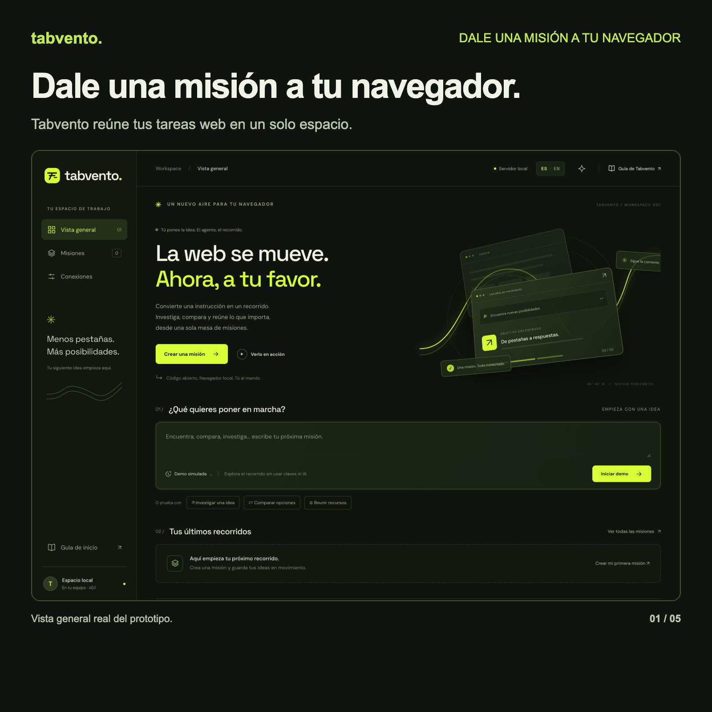
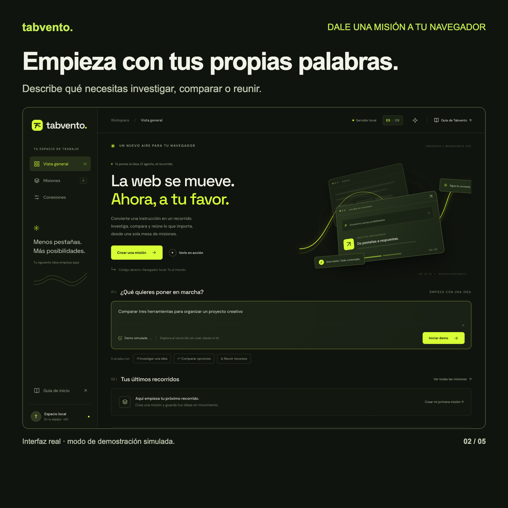
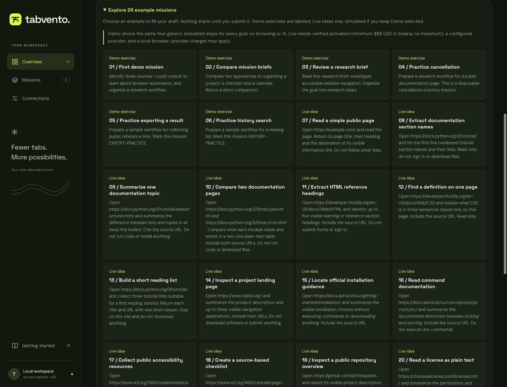
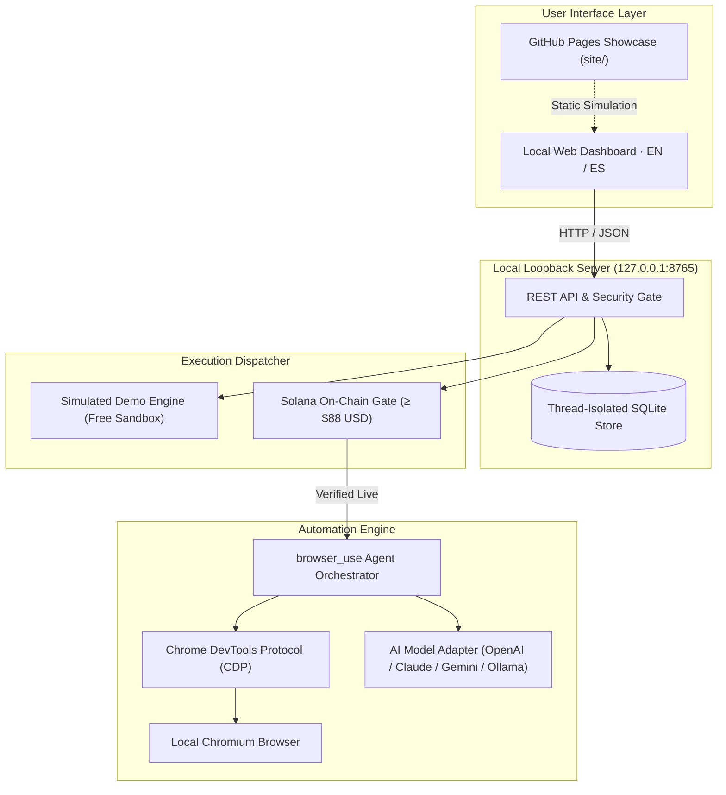

  

<h1 align="center">Tabvento</h1>

<strong>Autonomous AI Browser Automation Dashboard</strong>

  A local-first, privacy-focused browser automation workspace. Run keyless simulated sandbox tests or unlock full local Chromium automation with your preferred AI provider.

  
  
  

---

## 🌟 Interactive Live Showcase

Experience Tabvento directly in your browser without installing anything:

👉 **[Launch Interactive GitHub Pages Showcase (https://annoris.github.io/tabvento/)](https://annoris.github.io/tabvento/)**

- **Simulated Mission Runner:** Watch step-by-step DOM interactions, telemetry HUD, and synthetic token counters in real-time.
- **24 Curated Presets Library:** Searchable and filterable business missions for Market Research, E-Commerce, Developer QA, Lead Gen, and Data Extraction.
- **Solana Web3 Gate Simulator:** Test Base58 signature validation against the official wallet.
- **Bilingual Switcher:** Instant one-click toggle between English (`EN`) and Spanish (`ES`).

---

## 📸 Interface & Workflow Gallery

  
  

  
  

  

---

## 💎 Solana Web3 Gate (Live Browser Mode Activation)

**Simulated Demo Mode (`mode: "demo"`) is completely free for evaluation.** To unlock **Live Browser Mode (`mode: "live"`)** with a real local Chromium browser and your configured AI model provider:

| Parameter | Specification |
|---|---|
| **Official Solana Wallet** | `3HvUMCUSSHEdtA35UuD4J7mbgpTxJ7LgT2X7GfdzvBdm` |
| **Minimum Contribution** | **$88.00 USD** (in native **SOL** or **USDC** on Solana Mainnet) |
| **Maximum Limit** | **No maximum limit** (contributions $\ge \$88\text{ USD}$ unlock permanent access) |
| **Verification Method** | Direct on-chain RPC lookup via Base58 transaction signature |
| **Persistence** | Unlocked permanently in local SQLite database (`tabvento.sqlite`) |

### How to Activate:
1. Transfer $\ge \$88\text{ USD}$ on Solana Mainnet to `3HvUMCUSSHEdtA35UuD4J7mbgpTxJ7LgT2X7GfdzvBdm` (or use the **Open in Solana Pay ↗** button in the dashboard).
2. Navigate to **Connections** (`http://127.0.0.1:8765#conexiones`).
3. Paste your Base58 transaction signature and click **Verify Solana contribution**.
4. Tabvento confirms the transaction on-chain and unlocks Live Browser Mode permanently.

---

## 🤖 Supported AI Model Providers

Configure your model in local environment variables (`.env`). API keys are never transmitted to the browser or stored in SQLite:

- **OpenAI:** `gpt-4o`, `gpt-4o-mini`, `o1`, `o3-mini` (`OPENAI_API_KEY`)
- **Anthropic Claude:** `claude-3-7-sonnet`, `claude-3-5-haiku` (`ANTHROPIC_API_KEY`)
- **Google Gemini:** `gemini-2.0-flash`, `gemini-1.5-pro` (`GOOGLE_API_KEY`)
- **Local Ollama:** `llama3.2`, `qwen2.5`, `mistral`, `deepseek-r1` via `http://127.0.0.1:11434/v1` (100% private, 0 external API cost)
- **OpenAI-Compatible Custom:** vLLM, Together, Groq, DeepSeek, OpenRouter (`TABVENTO_COMPATIBLE_API_KEY`)

---

## 📚 24 Production Mission Presets

Tabvento includes 24 built-in mission presets engineered for Small & Medium Businesses, local service providers, marketing agencies, and operations:

| Category | Count | Example Scenarios |
|---|:---:|---|
| **Market Research** | 4 | Competitor pricing audits, industry news digest, tech stack detection |
| **E-Commerce** | 4 | Stock inventory monitoring, catalog price scraping, shipping policy analysis |
| **Developer QA** | 4 | Broken link scans, responsive navigation audit, accessibility checks |
| **Lead Generation** | 4 | Local business contact discovery, agency portfolio enrichment, directory search |
| **Data Extraction** | 4 | Financial table parsing, structured event aggregation, PDF download automation |
| **Workflow Automation** | 4 | Multi-step form completion, simulated tour, comparative checklist synthesis |

---

## 🏗️ Architecture

---

## 🔒 Security & Privacy Boundaries

- **Loopback Enforcement:** Binds strictly to `127.0.0.1`, enforcing strict `Host`, `Origin`, and `Content-Security-Policy` headers to block cross-origin attacks and DNS rebinding.
- **Zero Cloud Leaks:** Your browsing sessions, cookies, user profiles, and extracted data never leave your local machine.
- **Key Isolation:** API keys remain strictly in server environment variables (`.env`).
- **Cancellation Guarantee:** Stopping an active mission aborts local execution immediately.

---

## 📄 License & Governance

- **Copyright © 2026 Tabvento. All Rights Reserved.** This public repository hosts the interactive showcase and public documentation for Tabvento under the proprietary terms in [LICENSE](LICENSE).
- Third-party components and bundled font assets retain their respective licenses (including MIT and SIL Open Font License). See [THIRD_PARTY_NOTICES.md](THIRD_PARTY_NOTICES.md).
- Governance & Policies: [Code of Conduct](CODE_OF_CONDUCT.md) · [Security Policy](SECURITY.md) · [Changelog](CHANGELOG.md).
