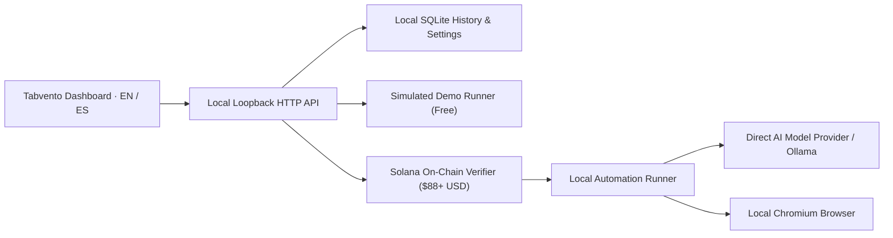

<p align="center">
  
</p>

<h1 align="center">Tabvento</h1>
<p align="center"><strong>Give your browser a mission.</strong></p>
<p align="center">A local-first AI browser automation dashboard. Bring your model, follow the mission, keep the history.</p>

Tabvento turns a browser task into a structured workspace you can follow: describe an objective, run a mission, and review its steps and result. The dashboard defaults to **English (`EN`)** with instant switching to **Spanish (`ES`)**, and includes a keyless **Simulated Demo Mode** so anyone can download and test the workflow before activating live execution.

**Copyright © 2026 Tabvento · Local-first AI Browser Mission Desk**

[Quick Start](docs/QUICKSTART.md) · [Full Guide](docs/tabvento.md) · [Official License](LICENSE) · [Contribute](.github/CONTRIBUTING.md) · [Security](.github/SECURITY.md)

---

## 1. Try Simulated Demo Mode (100% Free, Zero Setup)

You need **Python 3.11+** and [uv](https://docs.astral.sh/uv/). From the project directory:

```bash
uv sync --locked --all-extras
uv run tabvento
```

Open **http://127.0.0.1:8765** in your browser and click **Start demo** (or select **Simulated demo** in the mission composer). Watch the mission progress through its timeline steps, inspect the result, and manage your local SQLite history.

- On macOS, you can also double-click `Tabvento.command`.
- Use `uv run tabvento --port 8766` if port `8765` is already in use.
- Simulated Demo Mode does not visit websites, call an AI model, or require an API key.

---

## 2. Unlock Live Browser Mode (Solana On-Chain Activation · Minimum $88 USD, No Maximum Limit)

**Simulated Demo Mode (`mode: "demo"`) is completely free.** To unlock **Live Browser Mode (`mode: "live"`)** with a real local Chromium browser and your configured AI provider:

- **Official Solana Wallet:** `3HvUMCUSSHEdtA35UuD4J7mbgpTxJ7LgT2X7GfdzvBdm`
- **Minimum Contribution:** **$88 USD** (in native **SOL** or **USDC** on Solana Mainnet)
- **Maximum Limit:** **No maximum limit** (any contribution equal to or greater than `$88 USD` is valid)
- **On-Chain Verification:**
  1. Send your contribution (`>= $88 USD`, no maximum limit) on Solana Mainnet to `3HvUMCUSSHEdtA35UuD4J7mbgpTxJ7LgT2X7GfdzvBdm` (or use the **Open in Solana Pay ↗** button in the dashboard).
  2. Open the **Connections** tab at `http://127.0.0.1:8765#conexiones`.
  3. Paste your Base58 **Solana Transaction Signature** and click **Verify Solana contribution**.
  4. Tabvento verifies the confirmed transaction on-chain and saves your unlocked activation in local SQLite.

### Configuring Your AI Model Provider for Live Missions

1. Install Chrome/Chromium (or install Chromium via `uv run python -m browser_use install`).
2. Copy `.env.example` to `.env` and set the API key for your chosen provider (`OPENAI_API_KEY`, `ANTHROPIC_API_KEY`, `GOOGLE_API_KEY`, or `TABVENTO_COMPATIBLE_API_KEY`). Restart Tabvento after updating `.env`.
3. In **Connections**, select your provider (OpenAI, Anthropic, Google Gemini, OpenAI-compatible API, or Local Ollama) and enter the exact model identifier.
4. Save the connection, select **Live browser**, and launch your mission.

> **Note:** API keys stay in your server environment (`.env`), never in browser forms or SQLite. External AI provider usage is billed directly by your provider, or you can use **Local Ollama** (`http://127.0.0.1:11434/v1`) with a local model at no external API cost.

---

## 3. Core Capabilities

| Capability | Description |
|---|---|
| **Mission Workspace** | Compose a task, track real-time execution steps, and export or copy results. |
| **Solana Web3 Gate** | On-chain Solana Mainnet verification (`>= $88 USD`, no maximum limit) to unlock live browser automation. |
| **Direct Model Providers** | Connect OpenAI, Anthropic, Google Gemini, any OpenAI-compatible endpoint, or Local Ollama. |
| **Local Chromium Execution** | Run live missions in a local Chromium browser on your machine. |
| **Persistent SQLite History** | Store mission records, connection settings, and Solana verification status locally. |
| **English & Spanish UI** | Default English (`EN`) interface with one-click toggle to Spanish (`ES`). |

---

## 4. Architecture



---

## 5. Security & Execution Boundaries

- **Loopback Protection:** The HTTP server binds to `127.0.0.1` and enforces strict `Host`, `Origin`, `Sec-Fetch-Site`, and `Content-Security-Policy` checks against cross-origin and DNS-rebinding requests.
- **User Permissions:** Live missions execute Python with your local user permissions, without a sandbox. Run only trusted tasks and review the [security policy](.github/SECURITY.md).
- **Cancellation:** Canceling an active mission stops local execution; it does not reverse actions already performed on external websites.

---

## 6. Development & Quality Checks

```bash
uv sync --locked --all-extras --dev
uv run pytest tests/ci tests/test_tabvento.py -m "not chrome"
npm ci --prefix tests/frontend
npm test --prefix tests/frontend
uv run ruff check --no-fix
uv run pyright
uv build
```

All tests use mocked models and simulated RPC responses without calling paid AI providers or external networks.

---

## 7. Official License & GitHub Compliance

**Copyright © 2026 Tabvento.** Distributed under the terms in [LICENSE](LICENSE).

- **Simulated Demo Mode:** Free for local evaluation.
- **Live Browser Mode:** Unlocked via verified Solana contribution (minimum **$88 USD** in SOL or USDC, no maximum limit) to `3HvUMCUSSHEdtA35UuD4J7mbgpTxJ7LgT2X7GfdzvBdm`.
- See [LICENSE](LICENSE), [commercial plan](docs/commercial-plan.md), and [third-party notices](THIRD_PARTY_NOTICES.md) for complete details.
