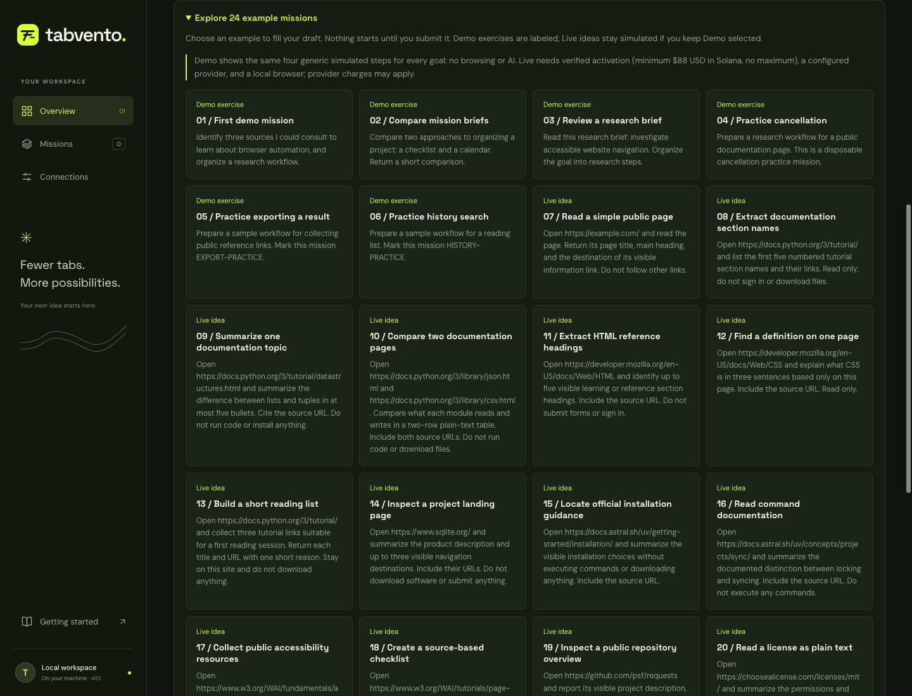
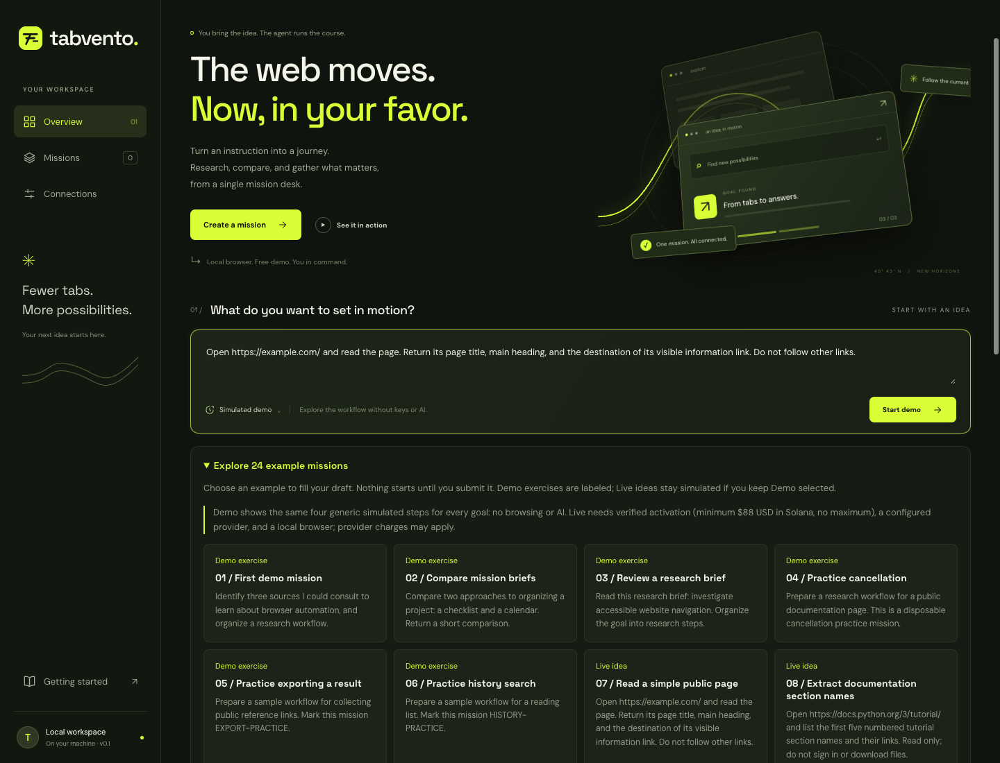
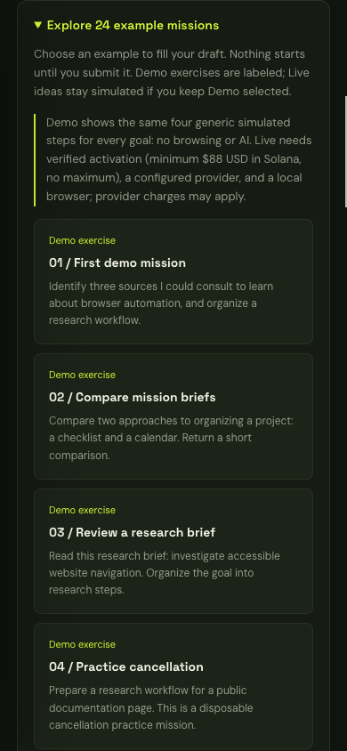
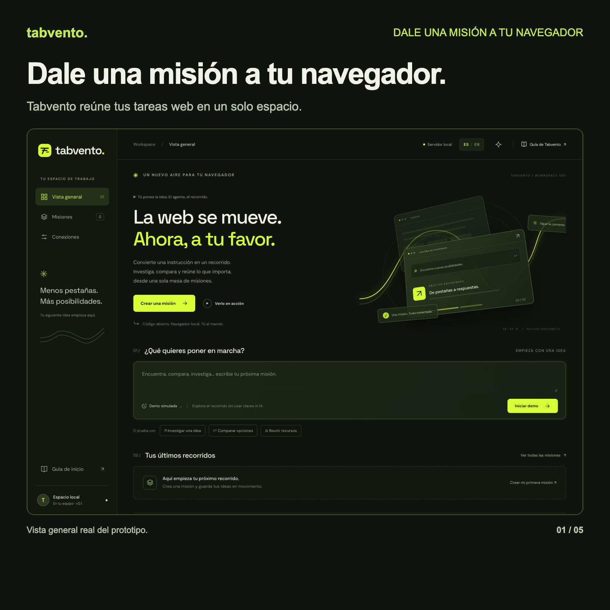
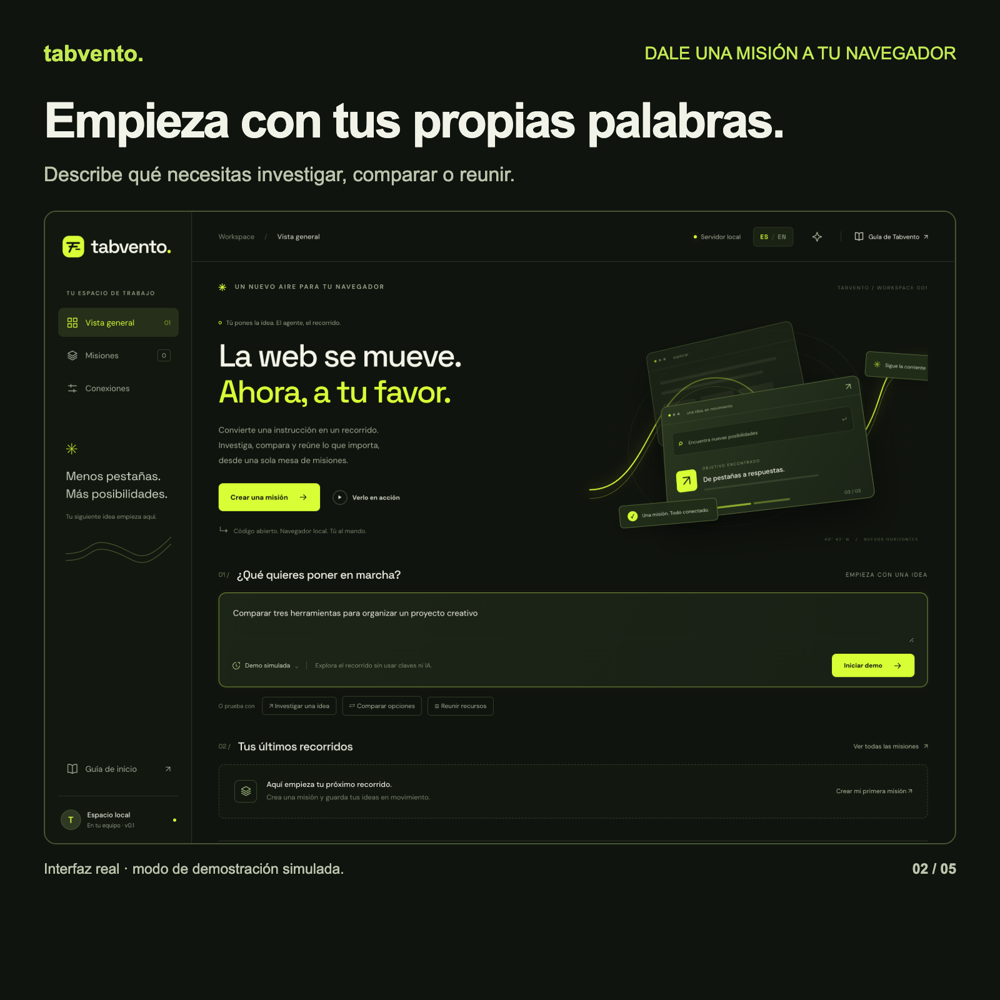
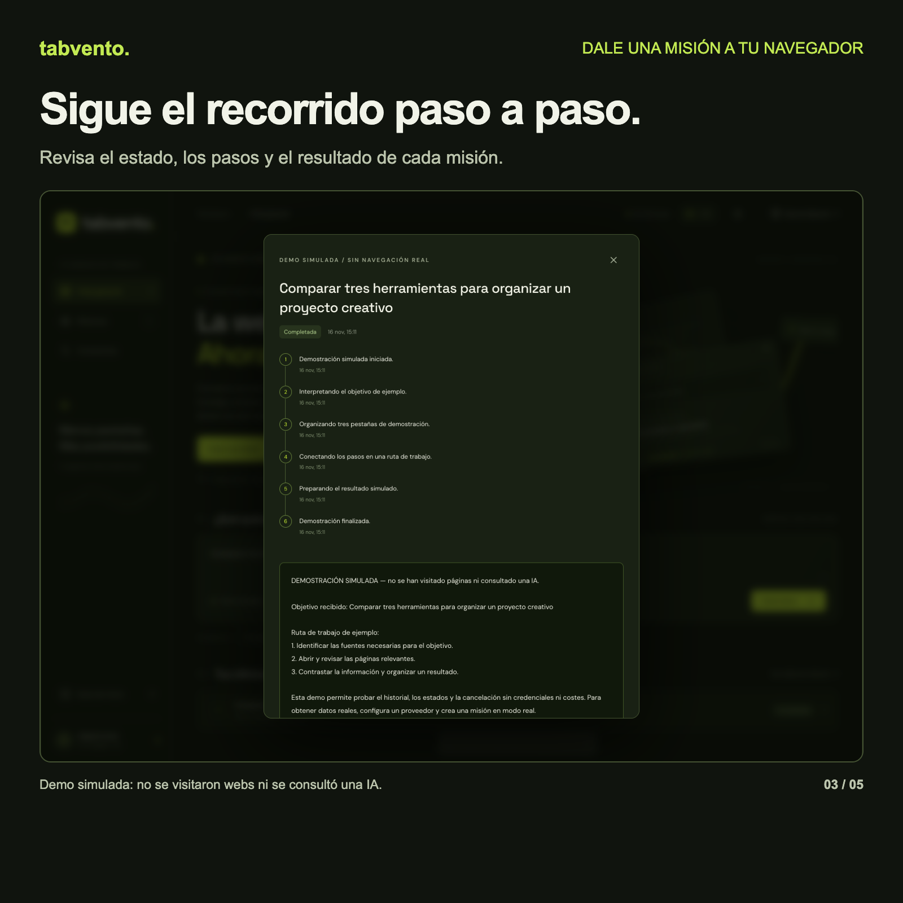
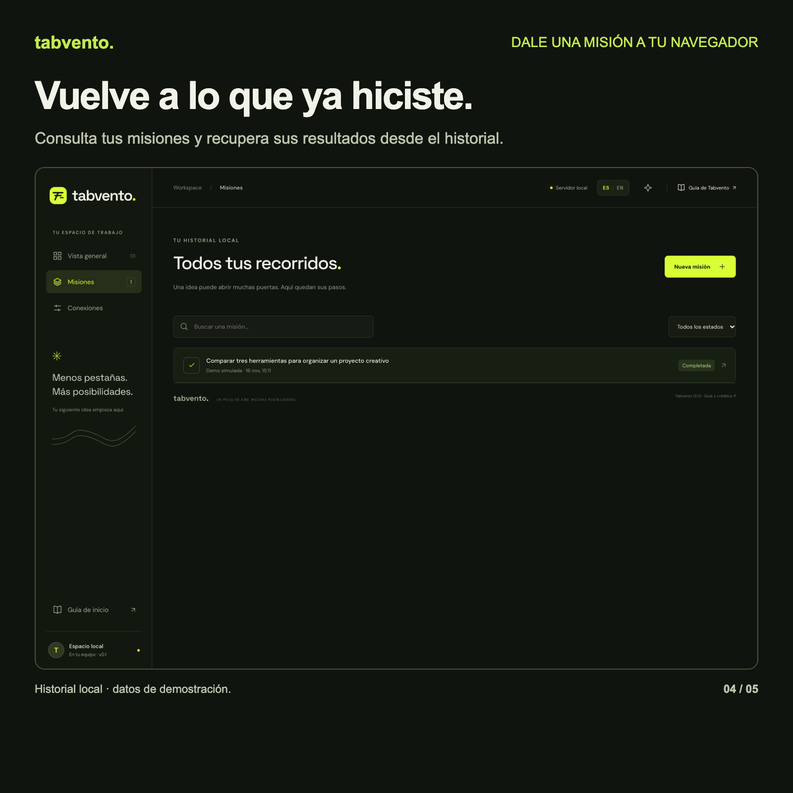
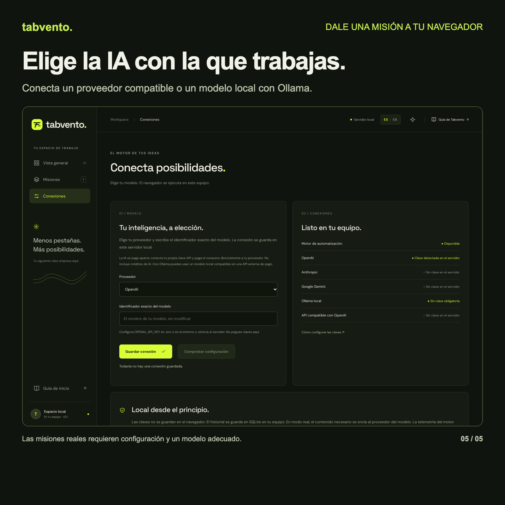

# Tabvento Visual Walkthrough

Use this tour to recognize the workspace before installing, then follow the [Quick Start](QUICKSTART.md) to try it locally. Start with the current in-app example library below, or read the [24 mission examples](EXAMPLES.md) for expected outcomes and prerequisites.

## Current interface: choose from 24 missions

In **Overview**, expand **Explore 24 example missions** beneath the composer. Cards 01–06 are Demo exercises; cards 07–24 are Live ideas. Selecting a card fills the draft and focuses the composer. It does not start a mission or change the selected mode. A Live idea stays simulated if you keep **Simulated demo** selected.



*Actual local application capture at 1440 pixels wide. The library continues vertically to card 24; scroll to see the remaining cards.*



*Card 07 has populated the draft. The mode remains Simulated demo and no mission has started. Choose the mode deliberately, then use the separate submit button when ready.*



*Actual local application capture at 390 pixels wide. The cards wrap into one column. The library heading and all 24 cards also translate through the EN / ES switch.*

These three current screenshots were captured locally with an isolated, empty data directory. The checks confirmed 24 cards, a filled draft after selection, zero started missions, and no horizontal page overflow at 1440 or 390 pixels. No activation payment, AI provider call, or external website mission was performed.

## Earlier visual tour

The five images in the numbered tour below are the repository's existing Spanish-language prototype captures, with presentation headings around the dashboard. They show actual demo interface states, not current-release screenshots or evidence of successful live missions. Current installations default to English; labels and activation controls may differ from these earlier images.

## 1. Open the workspace

From the project directory:

```bash
uv sync --locked --all-extras
uv run tabvento
```

Open `http://127.0.0.1:8765`. The left navigation separates **Overview**, **Missions**, and **Connections**. The top bar provides the **EN / ES** switch. Overview contains the mission composer and recent history.



*Overview before the first demo. The green artwork is interface decoration; it does not show browser tabs opened by an agent.*

## 2. Write a first demo mission

In **Overview**, enter:

```text
Compare three tools for organizing a creative project.
```

Choose **Simulated demo**, then **Start demo**. No model key, browser installation, or activation payment is needed. The screenshot shows the equivalent Spanish prompt in the composer.



*The task is ready to submit. Demo mode illustrates the same workflow for different prompts; it does not research or compare the named tools.*

## 3. Read the timeline and result

Open the mission detail to follow its status and recorded steps. After completion, the result explicitly identifies itself as a simulation and repeats the submitted goal. Its sample workflow describes a possible research process; those steps are not a record of websites actually visited.



*A completed demo record. The notice states that no pages were visited and no AI was queried.*

In the current interface, **Copy result** copies the result text and **Download** saves a text mission record. You can also try **Cancel mission** while another demo is running. Cancellation stops the remaining work; for live missions it does not undo external actions already taken.

## 4. Find the mission again

Select **Missions**, search for part of the task, or filter by status. Open a record to revisit its timeline and result. Finished records can be removed with **Remove from history**; deletion is not required to run another mission.



*Local history with one completed demo. These sample data are not a live research result.*

## 5. Understand Connections before Live mode

**Connections** stores the selected provider and exact model identifier. API keys belong in the server environment or local `.env`, not in this form. Restart the server after changing `.env`. For Ollama, run the local service and use a model already installed there.



*An earlier Connections layout. “Key detected” indicates local configuration, not provider authentication or available credit. This image does not show the current Solana activation panel.*

**Check configuration** checks local requirements; it does not authenticate with your provider. Save the exact identifier supplied by your provider without substituting another model name.

## 6. Prepare a real browser mission

For official Live Browser Mode, complete the [activation and provider setup](QUICKSTART.md#3-unlock-and-run-live-browser-missions): verify a Solana Mainnet activation payment of at least **$88 USD** in SOL or USDC to `3HvUMCUSSHEdtA35UuD4J7mbgpTxJ7LgT2X7GfdzvBdm` (no maximum), install a compatible local browser, and save your provider connection. Model usage is billed separately by the provider; Ollama uses your local service.

Then return to **Overview**, choose **Live browser**, and begin with a small public-page task:

```text
Open https://example.com/. Report the page title and its main visible heading.
Do not submit forms, sign in, or change anything.
```

This is a suggested live task, not an executed result. Success means the mission returns the requested information from the page it actually opened. The answer and duration depend on the browser, site, selected model, and provider. A failed mission should be inspected in its detail view rather than treated as a completed result.

The five images above demonstrate navigation, composition, simulated results, history, and provider configuration. They do not demonstrate an activation payment, authenticated provider call, or live browser execution. This walkthrough reviews those documented flows; it is not a full application audit.

[24 Mission Examples](EXAMPLES.md) · [Quick Start](QUICKSTART.md) · [Full Guide](tabvento.md) · [Back to README](../README.md)
